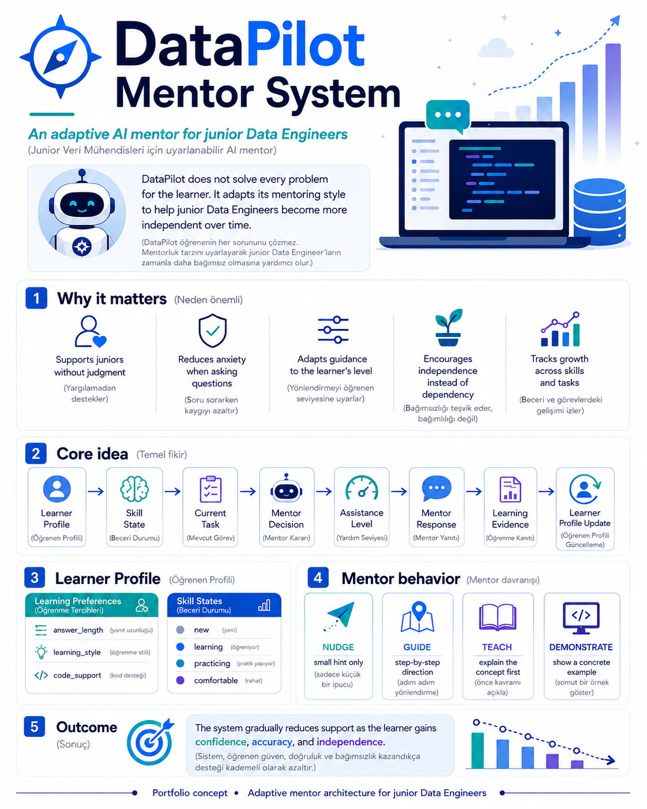
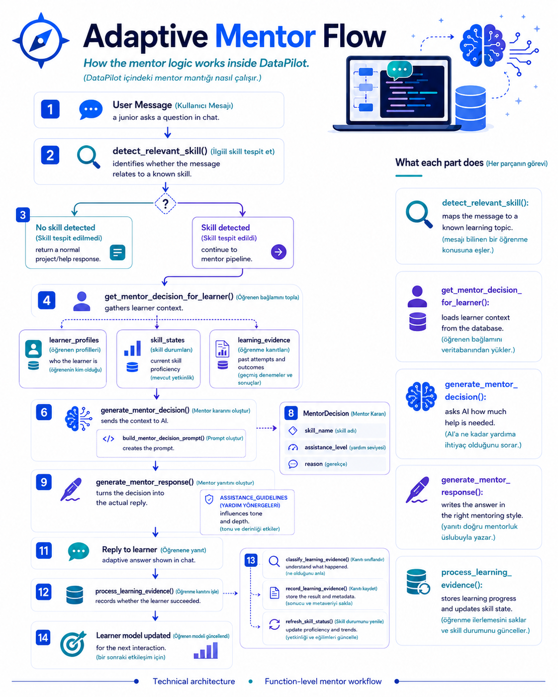

<div align="center">

# DataPilot AI

### Learn by doing. Build with evidence. Become more independent.

**An AI-assisted learning and data project workspace for aspiring and junior data professionals.**

[Explore the approach](#why-datapilot-ai) · [See the case studies](#case-studies) · [Understand the limitations](#project-status--limitations)

</div>

<p align="center">
  
</p>

> **Status: Active development / personal prototype.** DataPilot AI includes implemented workspace and learning features, but it is not a production-ready, hosted service. Some workflows still need end-to-end verification.

## Why DataPilot AI?

DataPilot AI started as a hands-on experiment to better understand Python, APIs, REST API design, retrieval-augmented generation (RAG), and practical AI integration.

While learning Data Engineering, I kept returning to a question:

**What if an AI assistant helped a beginner understand and solve a problem, instead of immediately providing the finished answer?**

That question became the product direction. DataPilot AI aims to combine **a real data workspace** with **adaptive mentoring and practice**, so learning happens while working on actual data problems.

The objective is not to replace a data professional's judgment. It is to support investigation, decision-making, validation, and gradually more independent work.

## The idea in one diagram

```text
Real data + a project goal
           |
           v
 Explore -> Investigate -> Transform -> Validate
           |                    |
           +---- Notebook ------+
                    |
          Adaptive AI Mentor
       (hints, guidance, practice)
                    |
           Evidence of learning
                    |
           Review and improve
                    |
        Data product / portfolio
```

The mentor aims to offer the **minimum sufficient help**, progressing from demonstration and teaching toward guidance, small hints, and independent work.

<p align="center">
  
</p>

## What is in the prototype?

| Area | Scope |
| --- | --- |
| **Personal Projects / Data Workspace** | Project goals, source datasets, data profiling, inspection, preparation, transformations, and validation flows |
| **Workbench and Notebook** | Interactive data exploration; Python/Pandas and SQL exercises and queries |
| **Data quality** | Missing values, duplicates, filtered inspection, and recorded quality findings/checks |
| **Modeling and BI** | Data model, KPI, analysis, and dashboard-building workflows |
| **Adaptive Mentor** | Skill-aware assistance, contextual guidance, learner progress and evidence tracking |
| **Practice** | Exercises, feedback, and opportunities to review concepts in separate learning activities |
| **Documents / RAG** | Experimentation with document retrieval and contextual AI answers |
| **Localization** | English, Dutch, and Turkish UI support |

These are **areas under active development**, not a claim that every feature is fully integrated or verified across all projects. In particular, mentor context, dataset scope, and some Notebook interactions remain under investigation.

### Personal Projects versus Secure Work

- **Personal Projects:** the main working prototype, focused on public/learning datasets and portfolio outcomes.
- **Secure Work:** a **preview / in-development direction**, not an audited enterprise-ready environment. Do not upload confidential company or client data.

## Case studies

The project is being developed and evaluated through real data-analysis exercises, rather than a single hard-coded dataset.

### 01 · Melbourne Housing — data project walkthrough

**Dataset:** Melbourne Housing (13,580 rows; 21 columns, according to the latest project record).

Work recorded in the project includes:

- Data profiling, missing-value investigation, and preparation
- Validation of data preparation steps
- Logical data modeling
- KPIs and analysis
- Dashboard design and exploration

This is the most developed **end-to-end workflow example** in DataPilot AI. However, the latest saved milestone shows **8 of 9 project deliverables completed**; final documentation, review/handoff status, and visual checks still need confirmation before calling it fully completed.

**Portfolio media:** verified application screenshots and a short walkthrough will be added after final UI review.

### 02 · Flight Delays & Cancellations — scale and reliability testing

**Dataset:** 2015 Flight Delays and Cancellations (5,819,079 source rows; 31 columns in the recorded workspace).

Current work investigates:

- Cancellations, cancellation reasons, missing data, and consistency checks
- Equivalent SQL and Pandas reasoning on the *same* data scope
- Differences between the **full source**, **development sample**, and **Notebook sample**
- Whether the mentor uses actual Notebook results rather than unsupported assumptions
- API/context errors, token limits, and reproducible quality checks

**Important scope note:** a recorded session used **10,000 development rows** and **5,000 Notebook rows**. Results from those samples must **not** be presented as findings for all 5,819,079 flights.

This case study is **in progress**. Full-data validation and performance claims are intentionally withheld until verified.

## Technology

| Layer | Technologies used |
| --- | --- |
| Backend and APIs | Python, FastAPI, Pydantic |
| Frontend | React, TypeScript, Vite, CSS |
| Data analysis and processing | Pandas, SQL, DuckDB, Parquet-oriented workflows |
| Persistence | SQLite, workspace-specific datasets and versions |
| AI and retrieval | AI provider integrations, document retrieval / RAG |
| Learning environment | Pyodide-based browser Python execution in supported flows |
| Quality assurance | Pytest, frontend TypeScript/build checks, manual workflow testing |

The presence of a technology in the codebase does not imply every planned integration or large-data path has passed full end-to-end testing.

## How I build it: AI-assisted development, with human verification

**I use AI coding tools extensively.** I do not claim to have manually authored every module or to have independently designed every technical implementation.

My hands-on role focuses on:

1. Identifying learning problems and defining the product goal.
2. Describing requirements and the expected user experience.
3. Reviewing generated behavior and asking how it works.
4. Testing features with real datasets, reproducing errors, and inspecting results.
5. Iterating on the design and documenting limitations and next steps.

AI contributes substantially to code generation and technical implementation. The project is also a learning process: **I am working to understand the architecture, Python/SQL behavior, data-engineering decisions, and tests behind the product.**

I treat AI-generated explanations as hypotheses to verify, not automatic proof that a result is correct.

## Project status & limitations

DataPilot AI is a **personal, actively developed prototype**.

Current known areas needing further verification or fixes include:

- **Dataset-scope transparency:** consistently label full-source, development, working-data, and Notebook samples.
- **Mentor grounding:** reliably use the latest code/output and avoid claiming to have seen evidence that was not available.
- **Provider and context limits:** investigate oversized mentor context and improve safe fallback behavior.
- **Notebook UX:** improve SQL comment handling and communicate dependent cell execution.
- **Recorded quality checks:** make sample provenance unambiguous and connect evidence to later validation/documentation stages.
- **Large-data processing:** benchmark and verify full-data workflows before making performance claims.
- **Secure Work:** authentication, isolation, offline/local AI, and enterprise protections are not production-certified.

For the current engineering and learning roadmap, see [docs/ACTIVE_ROADMAP.md](docs/ACTIVE_ROADMAP.md).

## Run the project locally (development)

Prerequisites: Python, Node.js/npm, and appropriate project configuration.

```bash
# Backend (from the repository root, with dependencies installed)
python -m uvicorn backend.app.main:app --reload

# Frontend (in another terminal)
cd frontend
npm install
npm run dev
```

Refer to [.env.example](.env.example) for example environment variables. Keep credentials out of the repository. Some AI features depend on configured provider access; behavior and quotas vary.

```bash
# Backend tests
python -m pytest -q

# Frontend typecheck + production build
cd frontend
npm run build
```

**Verification note:** these are commands, not a statement that the complete test suite passed on the latest commit. Development notes contain dated, scoped test results; they should not be treated as a fresh full-suite run.

## Next steps

- Confirm the Melbourne walkthrough, end-to-end status, and screenshots.
- Resolve Flight dataset-scope and mentor-evidence issues using reproducible test cases.
- Connect Notebook quality evidence to validation, documentation, and delivery.
- Test additional datasets to reduce dataset-specific assumptions.
- Prepare an honest, short portfolio demo based on **real application recordings**.
- Continue hardening the product before broader beta use.

---

**DataPilot AI is a learning journey and a working software experiment — not a claim of production readiness.**

*Feedback, code review, and thoughtful discussion about junior Data Engineering learning are welcome.*
