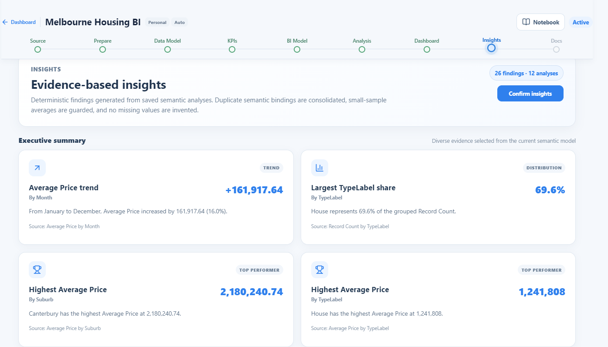
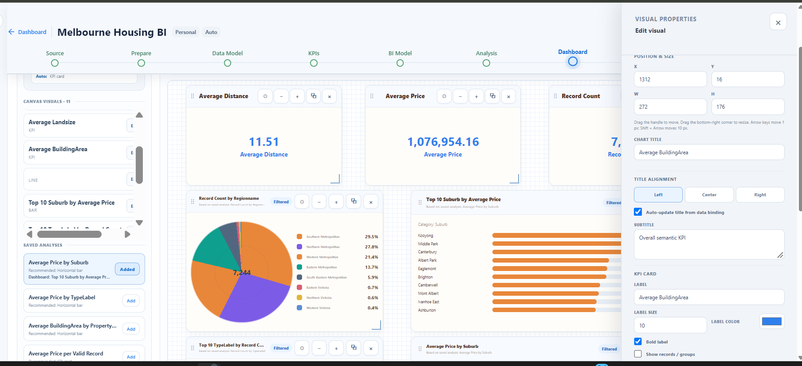
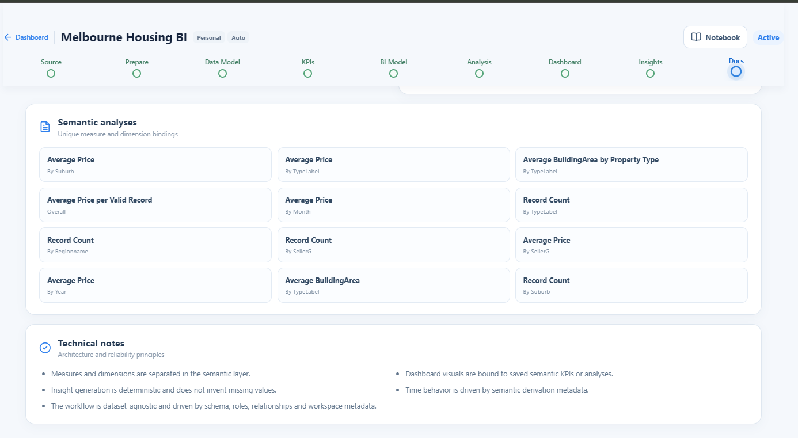
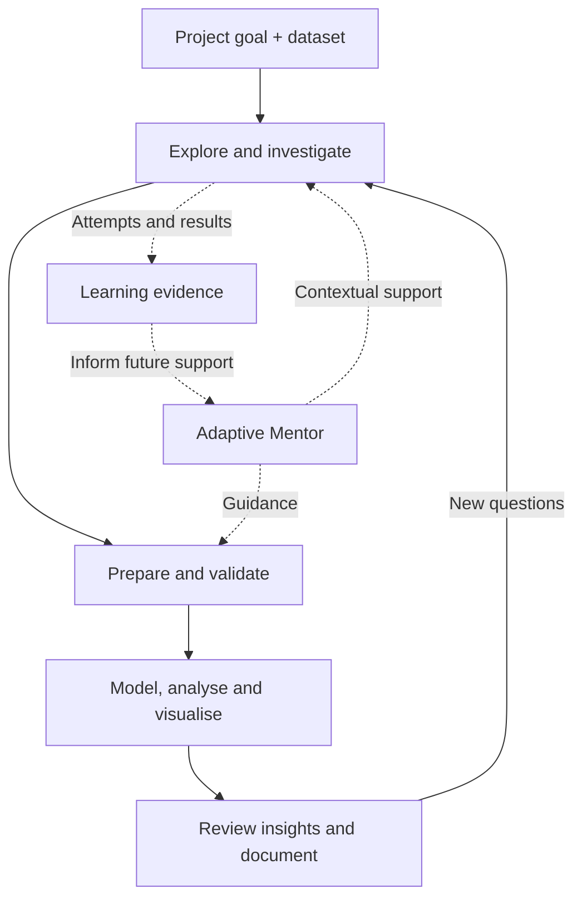
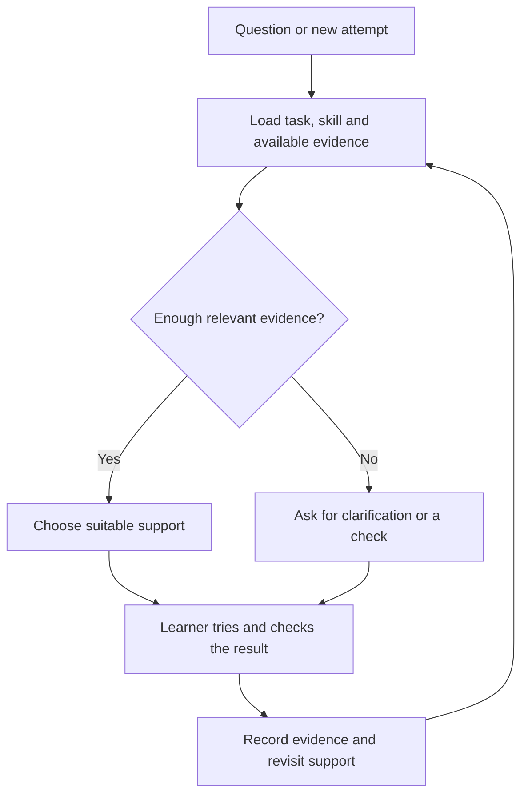

<div align="center">

# DataPilot AI

### Build data projects. Understand your decisions. Grow more independent.

An adaptive learning and project workspace for aspiring and junior data professionals.


[Why it exists](#why-it-exists) · [Explore the workspace](#explore-the-workspace) · [Adaptive Mentor](#adaptive-mentor) · [Current progress](#current-progress) · [Run locally](#run-locally)

</div>



<p align="center"><sub>Actual application screenshot · Melbourne Housing BI · development snapshot, 13 October 2026</sub></p>

> **Active development.** A working personal prototype with implemented data and learning workflows. Mentor reliability and integration are still being tested. Use locally with public learning data; read the [security review](docs/SECURITY_REVIEW_2026-10-15.md) before running it.

## Why it exists

Finishing a course and starting a real data task are different experiences. A beginner may know Python or SQL but still wonder: **Where do I start? Is this missing value actually a problem? How do I know my result is trustworthy?**

I started DataPilot AI after studying web development, Python, data engineering and Microsoft Fabric. I wanted to refresh what I had learned through realistic projects, with a place to ask questions freely and practise the reasoning behind each step.

The goal is to bring **data work, contextual guidance and learning evidence** into one environment. The learner investigates and makes decisions; the Mentor aims to offer enough support to help them take the next step.

| The learning problem | The product approach |
| --- | --- |
| Knowing syntax but struggling to begin | A project goal and a visible sequence of work |
| Receiving an answer without understanding it | Hints, guided questions and explanations suited to the situation |
| Losing track of what was tried | Notebook work, saved project state and learning records |
| Treating a plausible explanation as proof | Inspect actual results, record scope and validate decisions |

**Long-term direction:** help a junior approach a realistic assignment more confidently and independently. Workplace use remains a future goal requiring stronger security, organizational approval and further evaluation.

## Explore the workspace

| Workspace area | What the learner can work on |
| --- | --- |
| **Personal Projects** | Define a goal, attach a dataset and follow project stages |
| **Workbench / Explorer** | Inspect types, missing values and duplicates; filter, group and count |
| **Notebook** | Investigate with Python/Pandas and SQL; compare approaches on the same data scope |
| **Data Model & BI Model** | Build tables, relationships and semantic definitions |
| **KPIs & Analysis** | Define measures and explore results by dimension |
| **Dashboard** | Arrange KPI cards, charts, tables and slicers; edit visual properties |
| **Insights & Docs** | Review findings from saved analyses and assemble project documentation |
| **Mentor, Practice & Progress** | Ask for contextual help, practise concepts and review learning evidence |
| **Tasks & Documents** | Track work and experiment with document retrieval / RAG |

The interface includes **English, Dutch and Turkish** support. Features are being developed for different datasets; Melbourne and Flight are test cases, not fixed product templates.

<details>
<summary><strong>View the dashboard editor and project documentation</strong></summary>



*The dashboard editor in use. The viewport shows part of the canvas and the selected visual's properties.*



*Saved analyses appear in the documentation stage. Screenshots show development state and do not certify analytical correctness or final delivery.*

</details>

### From a question to a documented result



The application stages are **Source → Prepare → Data Model → KPIs → BI Model → Analysis → Dashboard → Insights → Docs**. Investigation can return to earlier stages as new questions appear.

## Adaptive Mentor

The core experiment is **how to help without taking over the learning task**. The Mentor combines project context, skill state, previous attempts and available execution evidence to decide how to respond.



*This diagram describes the intended decision loop; individual Mentor paths remain under evaluation.*

| Support | Intended purpose |
| --- | --- |
| **NUDGE** | A small hint to prompt independent thinking |
| **GUIDE** | A question or a manageable next step |
| **TEACH** | Explain a concept and its reasoning |
| **DEMONSTRATE** | Show an example when needed |
| **NONE** | Continue without additional assistance where appropriate |

Local rules and deterministic checks handle supported cases; language models provide explanations and other context-dependent assistance. This aims to reduce unnecessary model calls. **Token savings and educational effectiveness have not yet been established by a measured evaluation.**

Progress indicators are learning signals, not professional competency scores. A single question should not be treated as proof of a skill gap. Practice recommendations and the choice of support level still need broader testing.

<details>
<summary>Earlier Mentor concept diagrams</summary>


*Concept illustrations retained for background; they are not current implementation specifications.*

</details>

## Current progress

**Documentation snapshot: 15 October 2026.** Repository code and developer-reported local application results are distinguished below. This documentation checkout passed **543 backend tests** and the frontend build; these checks do not certify Mentor decisions or security.

### Melbourne Housing · the most developed walkthrough

The developer's latest local walkthrough covers preparation, modeling, KPIs, analysis, dashboard creation, Insights and Docs. The reported project includes **1 fact table + 7 dimensions, 11 KPIs, 12 analyses and 11 dashboard visuals**. The inspected Insights screenshot shows **26 findings across 12 analyses**.

**Still open:** final export and the explicit project-completion action were intentionally left pending. Earlier roadmap notes predate this walkthrough. These milestones describe a development example, not an independently audited housing analysis.

### Flight Delays & Cancellations · the active reliability case

The recorded source contains **5,819,079 flights**, in an approximately **592 MB CSV**. Work focuses on missing-data reasoning, SQL/Pandas comparisons, larger-data workflows and whether Mentor responses use actual Notebook evidence.

| Data scope | Recorded size | How to interpret results |
| --- | --- | --- |
| Full source | 5,819,079 rows | Full-data claims require checks against this scope |
| Development sample | 10,000 rows | A smaller working context for development |
| Notebook sample | 5,000 rows in the recorded session | Findings apply to this sample only |

The latest detailed saved roadmap records **4,932 missing cancellation reasons in the 5,000-row Notebook sample** and **68 cancelled flights with a populated reason**. Earlier 10,000-row investigations recorded 9,855 missing reasons. These are different scopes, not interchangeable totals.

**Resume point:** confirm the active scope and latest Notebook output, continue investigating flight-status and missing-value relationships, and test Mentor grounding. Full-source validation remains pending. The developer's Windows integration branch and live workspace cannot be inspected from this documentation checkout.

### What needs improvement next

| Priority | Work to verify or improve |
| --- | --- |
| **Mentor reliability** | Use the latest output, ask when evidence is missing, choose suitable help and avoid unsupported interpretations |
| **Scope & provenance** | Keep full source, development data and Notebook samples explicit in results and quality records |
| **Notebook & integration** | Recheck cell dependencies, SQL comment handling, output freshness and branch integration |
| **Validation & delivery** | Connect saved quality evidence to validation and Docs; verify dashboard KPI references |
| **Scale & efficiency** | Benchmark full-data processing, context size, latency and model usage; test more datasets |
| **Security** | Authenticate users, enforce ownership, bound uploads and isolate untrusted execution before shared hosting |

Some fixes exist on separate branches; an item is not marked resolved until integration and behavior are verified. Detailed continuation records: [active roadmap](docs/ACTIVE_ROADMAP.md), [portfolio handoff](docs/PORTFOLIO_HANDOFF_2026-10-13.md), [current documentation checkpoint](docs/README_REVIEW_CHECKPOINT_2026-10-15.md).

## Technology

| Layer | Technologies and role |
| --- | --- |
| **Interface** | React · TypeScript · Vite · CSS |
| **API** | Python · FastAPI · Pydantic |
| **Data processing** | Pandas · SQL · DuckDB · Parquet workflows |
| **Storage** | SQLite and local workspace files |
| **AI** | Groq provider integration using the OpenAI-compatible client; provider and usage guards |
| **Browser execution** | Pyodide in supported Python/Notebook flows |
| **Retrieval** | Document ingestion, embeddings and RAG experiments |
| **Verification** | Pytest · TypeScript/build checks · manual workflow tests |

The example configuration selects Groq **GPT-OSS 120B** for mentoring/classification and **GPT-OSS 20B** for translation/practice generation. Runtime overrides may differ. Document embeddings currently use a separate OpenAI path, blocked by the default billing policy; a Groq key alone does not enable every RAG feature.

## Run locally

**For a trusted single user and public learning datasets.** Keep both development servers on loopback. Authentication and tenant isolation are incomplete; do not expose this prototype as a public or shared service.

You need Git, Python compatible with the pinned [backend requirements](backend/requirements.txt), and a Node.js/npm version compatible with the locked frontend dependencies. Frontend installation and build passed in this documentation environment; see the checkpoint for exact validation scope.

<details>
<summary><strong>1 · Backend setup</strong></summary>

From a terminal:

```bash
git clone https://github.com/Harriery/datapilot-ai.git
cd datapilot-ai
python -m venv .venv
```

Activate the environment:

```powershell
# Windows PowerShell
.\.venv\Scripts\Activate.ps1
```

```bash
# macOS / Linux
source .venv/bin/activate
```

Then:

```bash
python -m pip install -r backend/requirements.txt
```

Copy `.env.example` to `.env` in the repository root (`Copy-Item .env.example .env` in PowerShell or `cp .env.example .env` in Bash). Add your own `GROQ_API_KEY` if you want to use the configured external Mentor.

**Current startup caveat:** legacy modules instantiate an OpenAI client at import time. With no `OPENAI_API_KEY`, startup may fail even for non-OpenAI workflows. A non-secret placeholder such as `OPENAI_API_KEY=local-placeholder-not-a-real-key` can satisfy client initialization for local evaluation. Keep `AI_FREE_ONLY=true`, `AI_ALLOW_PAID_PROVIDER=false`, and OpenAI excluded from `AI_FREE_PROVIDER_ALLOWLIST`; the placeholder cannot enable OpenAI features. This dependency needs cleanup.

Start from the repository root:

```bash
python -m uvicorn backend.app.main:app --host 127.0.0.1 --port 8000 --reload
```

`.env` is ignored by Git. Never put provider keys in frontend code. The example's 120 daily / 1,500 monthly request limits are local guards, not a provider quota or a guarantee of free usage. Check your own provider account before making requests.

</details>

<details>
<summary><strong>2 · Frontend setup</strong></summary>

In a second terminal, from the repository root:

```bash
cd frontend
npm ci
npm run dev -- --host 127.0.0.1 --port 5173
```

Open [http://127.0.0.1:5173](http://127.0.0.1:5173). The current browser Python runner downloads Pyodide assets from a CDN, so those flows require network access. This is not an offline or air-gapped setup.

</details>

<details>
<summary><strong>3 · Verification commands</strong></summary>

Backend, from the repository root with the Python environment active:

```bash
python -m pytest -q
```

Frontend, from `frontend/`:

```bash
npm run build
```

This documentation checkout passed **543 backend tests** and the frontend build. See the checkpoint for environment details and warnings. Historical local test counts belong to their original branches and dates.

</details>

## Security and data boundaries

The code includes data-classification rules, external-AI policy checks, usage guards and some ownership checks. **Those controls do not yet form a complete security boundary.** Confidential/company datasets should not be used for this prototype evaluation.

The [15 October security review](docs/SECURITY_REVIEW_2026-10-15.md) records source-confirmed authentication, upload and browser-execution concerns, plus dependency audit findings: five high-severity npm package entries and Python advisories affecting `anyio` and `pypdf`. These matches require remediation and exposure analysis; they are not evidence of a confirmed compromise. The [security roadmap](docs/SECURITY_ROADMAP.md) describes intended hardening; checklist entries are not audit evidence. “Secure Work” remains a preview direction.

## How I build it

I use **AI-assisted development extensively**, including substantial code generation and implementation support. My role is to define the learning problem, shape requirements and workflows, test with real datasets, reproduce problems and evaluate the resulting behavior while learning the underlying technology.

This portfolio demonstrates a developing product and a documented learning process. It does not claim that I independently authored every module or that AI-generated code and explanations are automatically correct.

## Reuse and contributions

Feedback and code review are welcome. **This snapshot has no project-level license file**; public visibility alone does not grant a general license to reuse or redistribute the code. A license decision is pending. External datasets and practice materials retain their own terms and attribution requirements.
